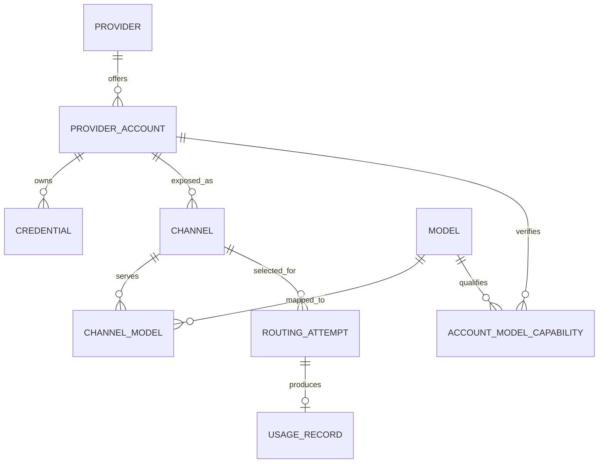

# Domain model

**Status:** CURRENT concepts plus TARGET vocabulary. This is a conceptual model, not a database migration specification.

## Terms

| Concept | Meaning | Current representation |
|---|---|---|
| Provider | Upstream vendor or integration family | Channel type/native adapter or provider plugin |
| Provider Account | Upstream tenant/account identity | Usually represented operationally by a Channel and its credential(s); no generic first-class ProviderAccount model was verified |
| Channel | Routable upstream connection | `model.Channel` |
| Credential | Secret used to authenticate to an upstream | `Channel.Key` lines or plugin credential records |
| Model | Client-visible or upstream model identifier | Channel model list, ability data, model metadata, model mapping |
| Capability | Verified ability of an account/model/protocol | Distributed across provider/model support today; no complete account-scoped capability registry was verified |
| Group | Routing/access grouping | Channel `Group` and user/API-token group configuration |
| Routing policy | Eligibility and selection rules | Existing group, model, constraints, priority, weight, retry, and affinity logic |
| Usage record | Request usage and cost/charge evidence | Existing relay logs, quota and billing models |

## Current Channel shape

The checked-in `model.Channel` includes fields such as:

- `Type`, `Name`, `Key`, `BaseURL`
- `Models`, `ModelMapping`, `Group`
- `Status`, `Priority`, `Weight`
- `Balance`, `BalanceUpdatedTime`
- `Other`, `OtherInfo`, `Setting`, `OtherSettings`
- `ChannelInfo`, including multi-key status and selection mode

This is a routable connection record, not a clean normalized Provider → Account → Credential relational model.

## Current multi-key shape

A Channel can hold multiple key lines. The current selection modes are random and polling. Plugin credential lines can carry plugin-specific credential data and non-secret account summaries. For provider-plugin multi-key channels, balance detail can be recorded by key index and aggregated for the channel.

This does not provide independent per-key Channel weight, priority, model mapping, base URL, or a complete per-key capability policy.

## Target conceptual relationship

**TARGET only:** the diagram describes domain concepts. It does not claim that these tables exist or should all be added.

## MVP mapping recommendation

- Use one Channel per independently routed upstream account.
- Keep multiple credentials inside one Channel only when they share the same routing policy and random/polling distribution is acceptable.
- Use the existing provider type/adapter or provider plugin to define vendor behavior.
- Do not add Provider, ProviderAccount, Credential, ChannelModel, or Capability tables until a concrete requirement cannot be represented safely with existing models and an ADR is accepted.

## Capability vocabulary

Capability data should eventually distinguish at least:

- protocol and endpoint support;
- modalities: text, image input, image output, audio input/output, video;
- tool/function calling;
- structured output / JSON schema;
- reasoning controls and reasoning output;
- streaming and background/task modes;
- context and output limits;
- region, account plan, and account-specific restrictions.

A capability must carry provenance (provider documentation, live probe, operator override), verification time, and confidence/status. Unknown must not be silently treated as supported.
