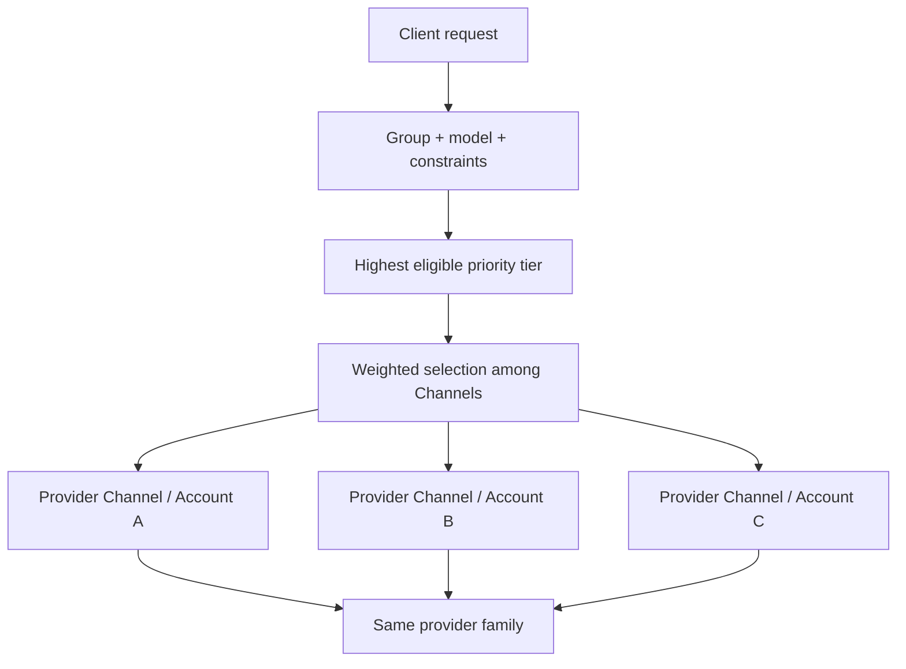
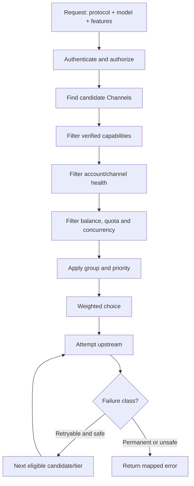

# Routing and load balancing

**Status:** CURRENT behavior verified at the inspected baseline; advanced policy is TARGET.

## Current Channel-level routing

The current implementation has Channel-level `Priority` and `Weight`. The selection path is principally:

- `service/channel_select.go`: resolves group, retry state, constraints, and request-level selection.
- `model/channel_cache.go`: filters candidates, orders unique priority tiers, and chooses a Channel.
- `model/channel.go`: exposes Channel properties and selects a credential within a multi-key Channel.

The current cached selector:

1. filters Channels by group, requested model (with normalized-model fallback), and request constraints;
2. sorts distinct priority values from highest to lowest;
3. selects the priority tier corresponding to the retry index;
4. performs weighted random selection among eligible Channels in that tier;
5. treats all zero weights as equal effective weights.

The exact behavior must be re-checked in source before changing it. Database fallback behavior and channel-affinity/group handling also matter.

## Current multi-key behavior

The current multi-key selector supports:

- `random`: choose randomly among enabled credential indexes;
- `polling`: choose the next enabled credential using a channel-specific polling index/lock.

Multi-key status metadata can disable individual keys. There is no current per-key weight mode in `constant/multi_key_mode.go`.

For provider-plugin multi-key channels, balance details may be stored per credential index and aggregated. This balance aggregation does not create per-key weighted routing.

## Recommended MVP pattern

For one provider with three independently governed accounts:

Create one Channel per independently routed account. Each Channel can then carry its own credentials, model list/mapping, status, priority, weight, balance visibility, and base URL/settings as supported by its type.

Use one multi-key Channel only when all credential lines can share the same Channel-level configuration and random/polling distribution is acceptable.

## Future routing pipeline

**TARGET — not a claim that this full engine exists today.**

Potential policy inputs, only when supported by reliable data:

- protocol, model, modality and required capabilities;
- group and access policy;
- credential validity and account status;
- provider health and recent failure rate;
- balance amount, currency, reset window and freshness;
- rate limits and concurrency;
- priority and weight;
- cost, latency and region preferences.

## Retry and failover rules

- Never retry invalid client input as a provider failure.
- Classify authentication, insufficient balance/quota, rate-limit, transient server, network, timeout, and protocol conversion errors.
- Do not automatically retry a non-idempotent task submission unless the upstream contract or an idempotency mechanism makes it safe.
- Do not mark an account unhealthy based only on a client-side validation or conversion failure.
- Preserve group, affinity, priority and retry semantics.
- Record the selected Channel and safe reason codes; never log raw keys or full sensitive prompts.

## Future per-account weighted keys

If the product later requires different weights inside one logical provider account pool, first decide whether separate Channels remain sufficient. If not, specify a first-class credential/account pool model, per-key health and rate limits, weighted algorithm, concurrency/locking, distributed coordination, persistence, migration, observability, and rollback in an ADR before implementation.
