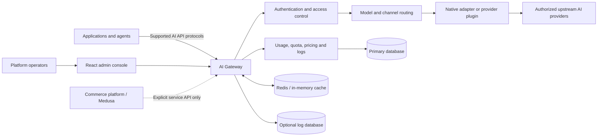
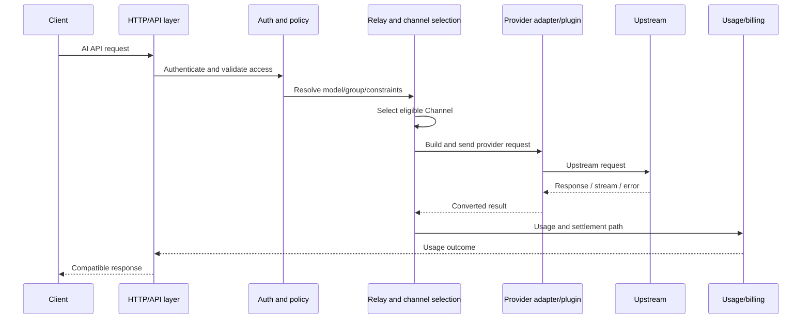

# System overview

**Status:** CURRENT baseline plus TARGET boundaries  
**Baseline inspected:** `c27abf36268001ebfcf4f478ba0f7bae1c19de22`

## Context

The repository currently contains the New API Go gateway and its web console. The AI Gateway project workstream should specialize and extend that implementation without replacing its identity or inherited architecture.

The commerce connection is a boundary, not an existing integration claim.

## Current technology

| Layer | Current implementation |
|---|---|
| Backend | Go, Gin |
| Persistence | GORM; SQLite, MySQL, PostgreSQL |
| Optional log storage | Separate log database; ClickHouse support |
| Cache | Redis and in-memory cache |
| Web console | React 19, TypeScript, Rsbuild 2, TanStack, Zustand, Tailwind CSS 4 |
| Frontend package manager | Bun |
| Protocol conversion | Independent `relaykit/` Go module |
| Token estimation | Independent `tokenkit/` Go module |
| Extensions | JavaScript plugin runtime in `pkg/jsplugin/` |
| Desktop wrapper | `electron/` |

Exact versions and scripts must be read from `go.mod`, nested module files, `web/package.json`, and build configuration at the current commit.

## Current request path (conceptual)

The actual call path varies by protocol, task type, plugin, and relay handler. Agents must inspect the concrete path rather than assume this diagram is a literal call graph.

## Target architectural principles

1. Keep the gateway as one deployable service for the MVP.
2. Separate provider identity, account identity, channel routing, model identity, and capability semantics in documentation and future domain design.
3. Reuse native channels and the existing provider-plugin API.
4. Keep request routing synchronous and bounded; move model discovery, balance polling, and scheduled maintenance to background operations.
5. Keep commerce catalogue, checkout, payment, and fulfilment outside the AI gateway.
6. Add new persistence only when current Channel/plugin representations demonstrably fail an accepted requirement.

## Key invariants

- API authentication and account authorization are enforced server-side.
- Provider credentials never become public model metadata.
- Usage/billing remains consistent across protocol conversions and retries.
- A retry must not duplicate a non-idempotent upstream operation.
- Routing decisions are explainable without exposing prompts or credentials.
- Existing database dialect support and independent Go module boundaries remain intact.
